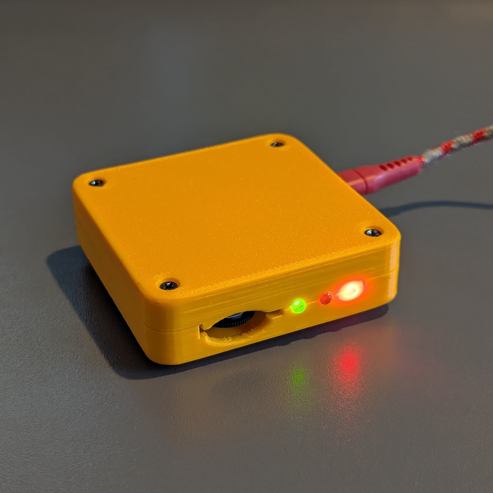
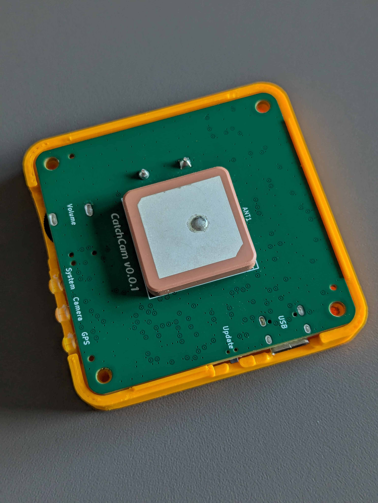

# Catchcam

<div style="display: flex;">
  
  
</div>

## About

Catchcam is a plug and play speed camera detector that works completely offline. It's similar to Waze or Radarbot, but with total privacy in mind - nobody tracks where you are, and no internet connection is needed. Just plug it into USB socket and drive.

It features:

- Built-in speaker and LED for alerts,
- Already packed with 66,000+ known speed camera positions world-wide, with more coming soon each day,
- Easy updates - just plug into your PC and drag-and-drop the latest software.

You can view the project progress on my blog [here](https://ivanvnucec.github.io/tags/#catchcam)

If you're interested, you can pre-order a sample by sending an email to [vnucec.ivan@gmail.com](mailto:vnucec.ivan@gmail.com).

### How it works

Catchcam uses a GPS module to determine your speed and position. It then compares your position to a database of known speed camera locations. If you're approaching a speed camera, Catchcam will alert you with a voice message spefiying the camera speed limit and a visual LED alert.

### Camera data sources

Speed camera database is updated daily from:

- [OpenStreetMap](https://www.openstreetmap.org/copyright) © OpenStreetMap contributors
- San Francisco: [DataSF](https://data.sf.gov/d/d5uh-bk84) (public domain, PDDL)
- Washington DC: [Open Data DC](https://opendata.dc.gov/datasets/03d94dc6579949ae9d7c9dd8ffebeb89) (CC BY 4.0)
- Chicago: [Chicago Data Portal](https://data.cityofchicago.org/d/4i42-qv3h)

> This site provides applications using data that has been modified for use from its original source, www.cityofchicago.org, the official website of the City of Chicago. The City of Chicago makes no claims as to the content, accuracy, timeliness, or completeness of any of the data provided at this site. The data provided at this site is subject to change at any time. It is understood that the data provided at this site is being used at one’s own risk.

### See it in action

[](https://www.youtube.com/watch?v=nnDtqLqS56w)

## How to update the device

To update the device, first you need to download the latest software from the [releases](https://github.com/IvanVnucec/catchcam/releases) page.

Then, press and hold the button on the device while plugging it into your PC. The device will show up as a USB drive, and you can drag-and-drop the new software onto it. After the update is complete, the device will restart and you're good to go.

## Development

### Prerequisites

- CMake 3.13+
- arm-none-eabi-gcc 10.3+
- Raspberry Pi Pico SDK (version 2.0.0)

### Setup

Clone the repository with submodules:

```sh
git clone https://github.com/IvanVnucec/catchcam --recurse-submodules
cd catchcam
```

### Build

```sh
# Configure the project
cmake -B build -S .

# Build the project
cmake --build build
```

### Flash

To flash the device, you need to put it into the bootloader mode. To do this, press and hold the button on the device while plugging it into your PC. The device will show up as a USB drive, and you can drag-and-drop the new software onto it located under `build/catchcam.uf2`. After the update is complete, the device will restart and you're good to go.
